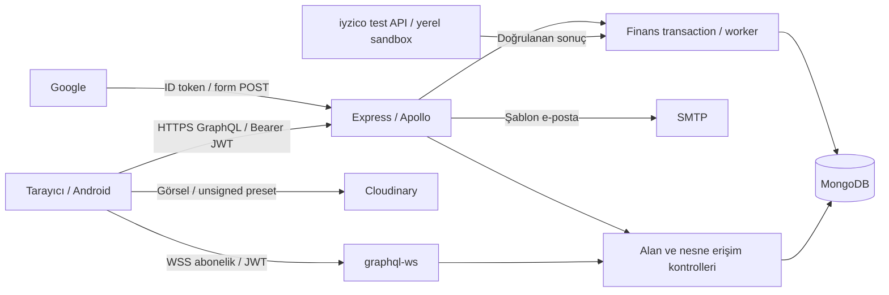

# Betik tehdit modeli

Tarih: 1 Kasım 2026. Kapsam: yerel kaynak kodu, kilit dosyaları, sentetik verili geçici MongoDB replica set testleri. Üretim, gerçek ödeme, SMTP teslimatı, Cloudinary hesabı ve hosting üzerinde aktif deneme yapılmaz.

## Doğrulanan mimari ve varlıklar

React 18 / React Router / Apollo Client / Quill istemcisi; Express 4 üzerinde Apollo GraphQL ve graphql-ws; Mongoose 8 / MongoDB; JWT Bearer kimlik doğrulama; bcrypt parolalar; Google Identity Services; Nodemailer; tarayıcıdan unsigned Cloudinary görsel yükleme. Android Capacitor kabuğu vardır. Öneriler uygulama içi veri/puan servisleridir; AI/LLM model veya araç çağrısı bulunmadı.

Kritik varlıklar: parola hashleri, oturum ve kurtarma belirteçleri, e-postalar, taslak/gizli kitap metni, özel alıntılar, mesajlar, sınırlı oturum iletileri, özel basım PDF'leri, AES-GCM şifreli teslimat adresleri, onaylı maliyet/satış fiyatı, rezervasyonlar, ödeme/ledger/iade ve yönetici denetim kayıtları.

## Veri akışları ve güven sınırları

İstemci rolü, kullanıcı kimliği, tutar, ödeme sonucu, HTML, origin ve dosya MIME beyanı güvenilir değildir. Sunucu kullanıcıyı JWT sonrası DB'den bulur. Finans/yönetim servisleri rolü transaction içinde yeniden okur. Dış sağlayıcı yanıtı kendi protokolüyle doğrulanmalı; tarayıcı dönüşü başarı kanıtı değildir. Public medya ile özel PDF deposu ayrıdır. Veritabanı yöneticisi ve deployment/secret yöneticisi uygulama güven sınırının dışındadır.

## Roller ve erişim

| Aktör | İzin / sınır |
| --- | --- |
| Misafir | Yayımlanmış katalog/içerik ve açık sosyal veriler; özel metin, hesap ayarları, finans detayı ve dosya yok |
| USER / yazar | Kendi kitabını düzenler; başkasının kitabına yazamaz; gizli bölüm yazarına görünür; özel alıntıyı yalnız sahibi okur |
| Destekçi | Kendi ödeme, sipariş ve adresi; başka destekçinin detayı yok |
| PUBLISHER | Kendi yayınevi portalı; genel ADMIN yetkisi yok |
| ADMIN | Güncel DB rolüyle yönetim; gerekçeli/revizyon kontrollü işlem; kendi basım başvurusunu onaylayamaz |
| Worker / sağlayıcı | Sadece tanımlı finans durum geçişleri; tutar ve referans eşleşmesi, tekilleştirme, uzlaştırma |

HTTP ve WebSocket aynı yetkilendirme politikasını uygulamalı. PRIVATE oturumun başlığı/kapağı listeleme metadatasıdır; iletileri için erişim kodu veya sahiplik gerekir. FOLLOWERS_ONLY iletileri yalnız oluşturucu ve güncel takipçiler içindir. Kullanıcı alanları/nested kitaplar da bu sınırları korumalı.

Bu ifade kullanıcı API'lerinin görünürlük kuralıdır; genel yönetim panelindeki güncel ADMIN içerik inceleme yetkisi ayrı bir güven sınırıdır. Platform, yöneticiye karşı uçtan uca şifreli mesaj/oturum gizliliği sunmaz. Özel alıntılar için ayrıca uygulanan sahiplik kuralı bu genel yönetici yetkisinden ayrıdır.

## STRIDE ve saldırgan senaryoları

| Kategori | Betik senaryosu | Kontrol / doğrulama hedefi |
| --- | --- | --- |
| S: Kimliğe bürünme | Parola/kayıt kodu denemesi, Google login CSRF, çalınan JWT replay | IP+hesap kotası, süre/deneme sınırı, CSRF cookie eşleşmesi, sürüm iptali |
| T: Değiştirme | Başkasının kitabını düzenleme; istemciden fiyat/rol/ödeme sonucu gönderme | Nesne sahipliği, GraphQL input sözleşmesi, DB'den güncel rol ve tutar |
| R: İnkar | Onay/iadeyi yapanın veya işlem geçmişinin kaybolması | Transaction'a bağlı audit, immutable ledger, gerekçe ve revizyon |
| I: Bilgi sızıntısı | Taslak, özel ileti, nested kitap, HTML-XSS ile JWT, hatada DB ayrıntısı | Alan kontrolleri, HTML allowlist, özel dosya ACL, genel hata yanıtı |
| D: Hizmet engelleme | Derin/alias/fragment/list sorgusu, regex, toplu PDF, bcrypt/SMTP suistimali | Sorgu bütçesi, input sınırı, hız/kota, literal regex, zaman aşımı |
| E: Yetki yükseltme | Sahte ADMIN claim'i, eski yetkili WS bağlantısı, genel JSON edit | Güncel DB rolü, allowlist alanlar, olay bazında oturum/erişim doğrulama |

Saldırgan profilleri: anonim bot; normal ama kötü niyetli hesap; kitap yazarı; kendi ödeme kaydını manipüle eden destekçi; rolü kaldırılmış yönetici; çalınan token sahibi; kötü niyetli dış içerik/sağlayıcı yanıtı; repo veya deployment sırrını ele geçiren kişi.

## Basım ve finans iş mantığı

Dijital yayın ve yazım tamamlanması, fiziksel başvuru/onay, kampanya ve üretim birbirinden ayrıdır. Başvuru: PREPARING → SUBMITTED → APPROVED / REVISION_REQUESTED / REJECTED; yazar iptali ayrıca kontrollüdür. Kampanya: ACTIVE → CLOSING → SUCCEEDED veya REFUNDING → REFUNDED / FAILED / CANCELLED. Başarı yalnız net ledger hedefe eşitse ve bekleyen iade/finans sorunu yoksa üretime geçer. Üretim PREPARATION'dan kontrollü ardışık adımlarla COMPLETED'a ilerler; iptal iadeye döner.

Tehditler: aynı anahtarla farklı sepet, eşzamanlı hedef/stok aşımı, geç capture, sahte webhook, çift iade, istemciden yabancı kullanıcı/adres/bedel, onaysız kampanya, maliyetin düşük gösterilmesi, geçmiş ödeme kaydını genel admin editörüyle değiştirme. Mevcut kodda kuruş tamsayısı, koşullu atomik rezervasyon, Mongo transaction, unique indeks, imza/tutar/referans kontrolü ve uzlaştırma vardır. Bunlar yeni düzeltilmiş açık olarak sayılmaz; mevcut testlerle yeniden doğrulanır.

Canlı tahsilat adaptörü yoktur. Yerel SANDBOX yalnız development/test koşullarında; IYZICO_SANDBOX sabit test API adresiyle çalışır. Gerçek sağlayıcı sözleşmesi, banka mutabakatı, gerçek kargo ve matbaa bu denetimde doğrulanamaz.

## Varsayımlar ve artık sınırlar

TLS/CDN/WAF, origin ve proxy zinciri, Cloudinary preset kotaları, DB ağı/yetkileri, yedek ve alarm konfigürasyonları kaynak kodundan kanıtlanamaz. Bunlar açık operasyon maddeleridir. SMTP ve ödeme testleri mock kullanır; gerçek hizmete istek başarı garantisi değildir. Raw DB yöneticisine karşı WORM/immutable depolama garantisi yoktur.
